# Fullcanchas

[](https://github.com/Lucianop5/FULLCANCHAS/actions/workflows/ci.yml)

Aplicación de reservas de canchas para un club deportivo. Permite explorar el catálogo, reservar por hora, pagar en un checkout demo, gestionar el historial y cancelar con política de 2 horas. Incluye un panel administrativo para canchas, precios, bloqueos, reservas y exportación CSV.

Rediseño completo en **Next.js 16 + React 19 + TypeScript**, con interfaz en español, precios en CLP y operación en `America/Santiago`.

## Demo

| Rol | Correo | Contraseña |
| --- | --- | --- |
| Administrador | `admin@fullcanchas.com` | `Admin1234!` |
| Gerente | `gerente@fullcanchas.com` | `Admin1234!` |
| Jugador | `jugador@fullcanchas.cl` | `Jugador1234!` |

> El checkout es una demostración: no se realiza ningún cobro real. La pasarela está detrás de la interfaz `PaymentProvider` para poder conectar un proveedor real más adelante.

## Capturas

| Landing — tema claro | Landing — tema oscuro |
| --- | --- |
| 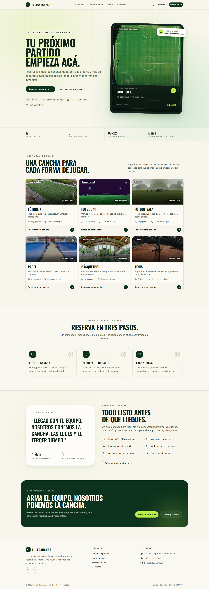 | 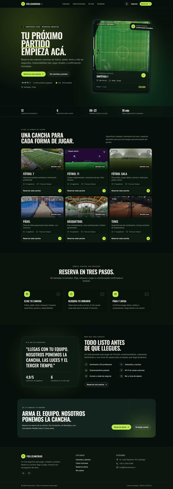 |

| Reserva | Checkout demo |
| --- | --- |
| 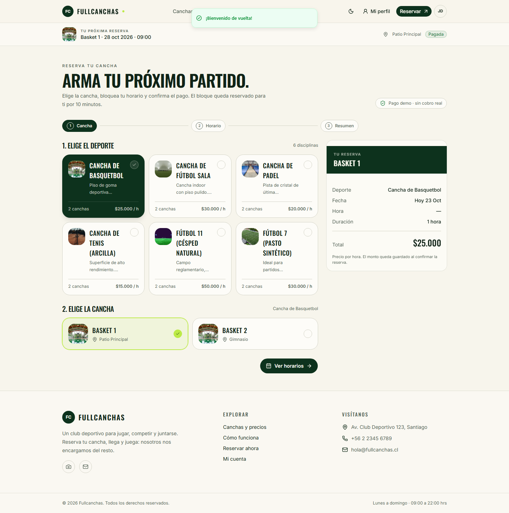 | 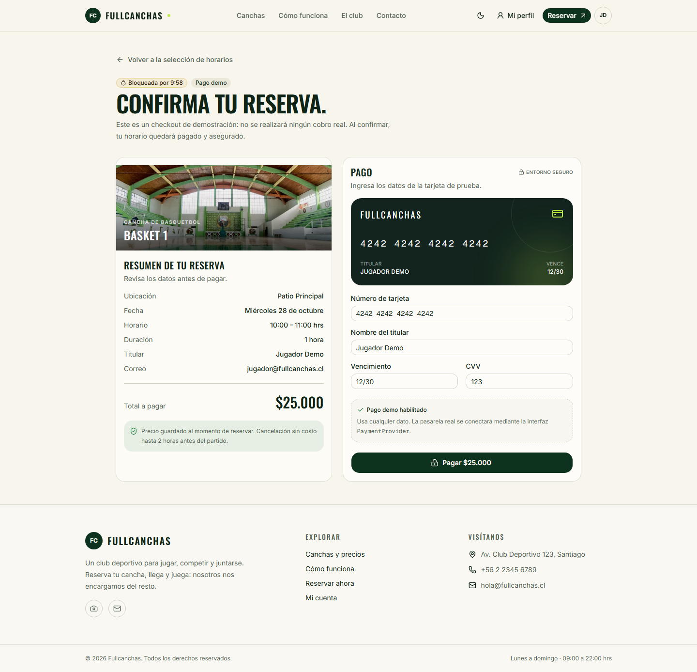 |

| Confirmación | Mi perfil |
| --- | --- |
| 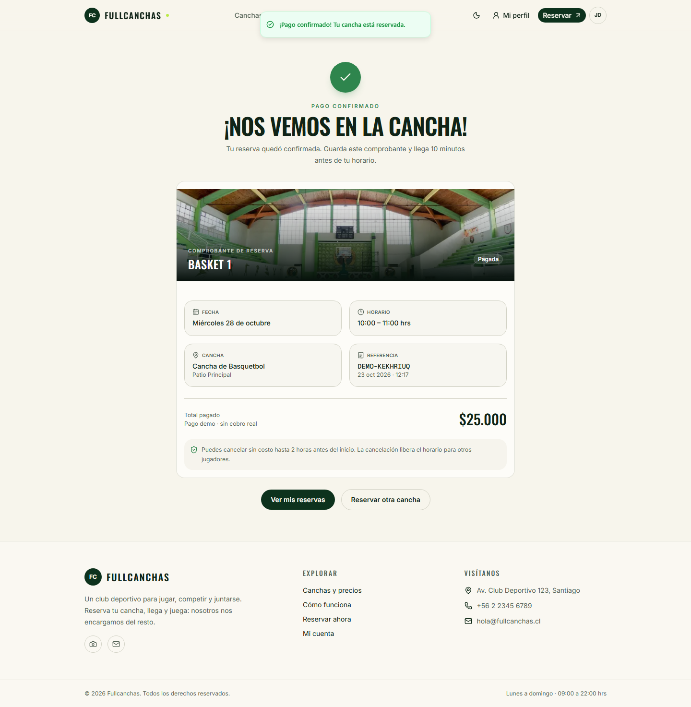 | 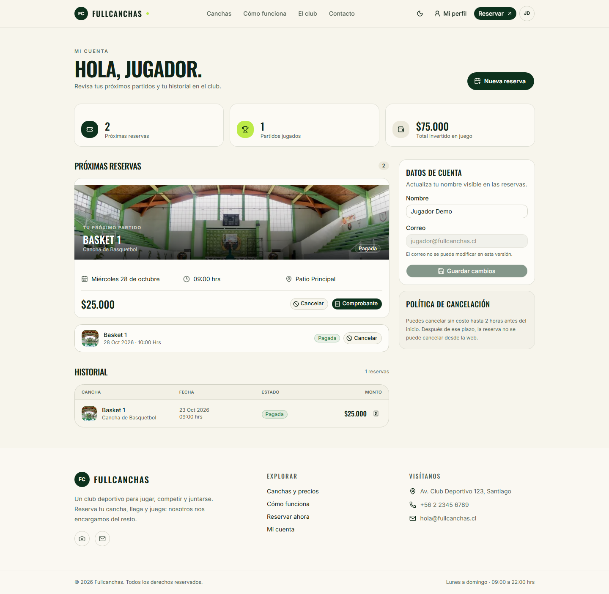 |

| Panel administrativo | Canchas y precios |
| --- | --- |
| 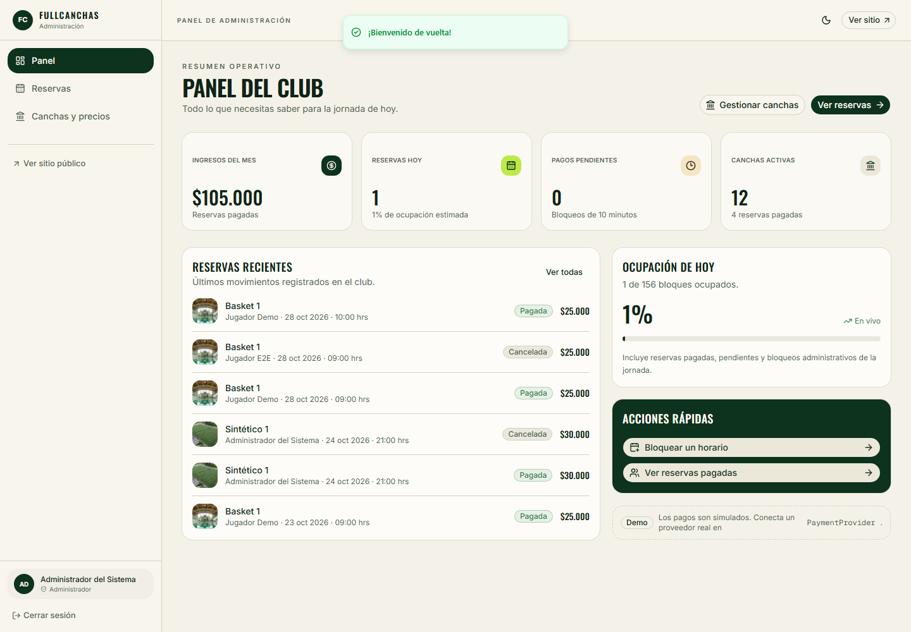 | 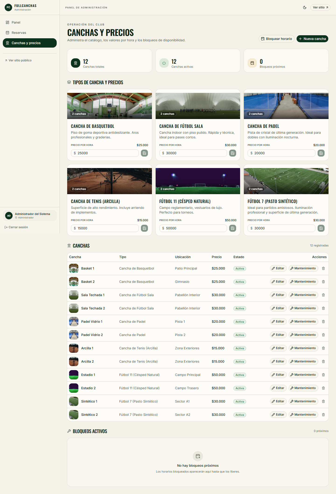 |

| Reservas administrativas | Landing móvil |
| --- | --- |
| 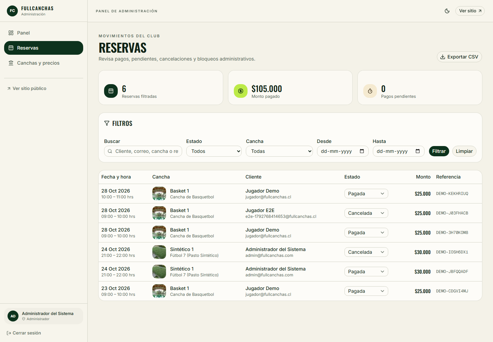 | 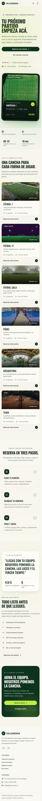 |

| Dashboard – tema oscuro | Perfil – tema oscuro |
| --- | --- |
| 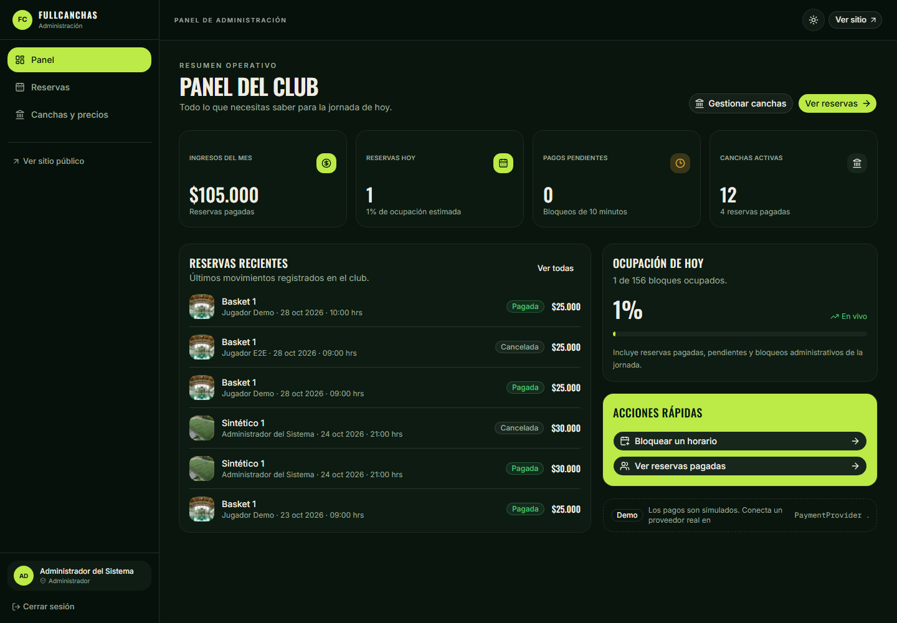 | 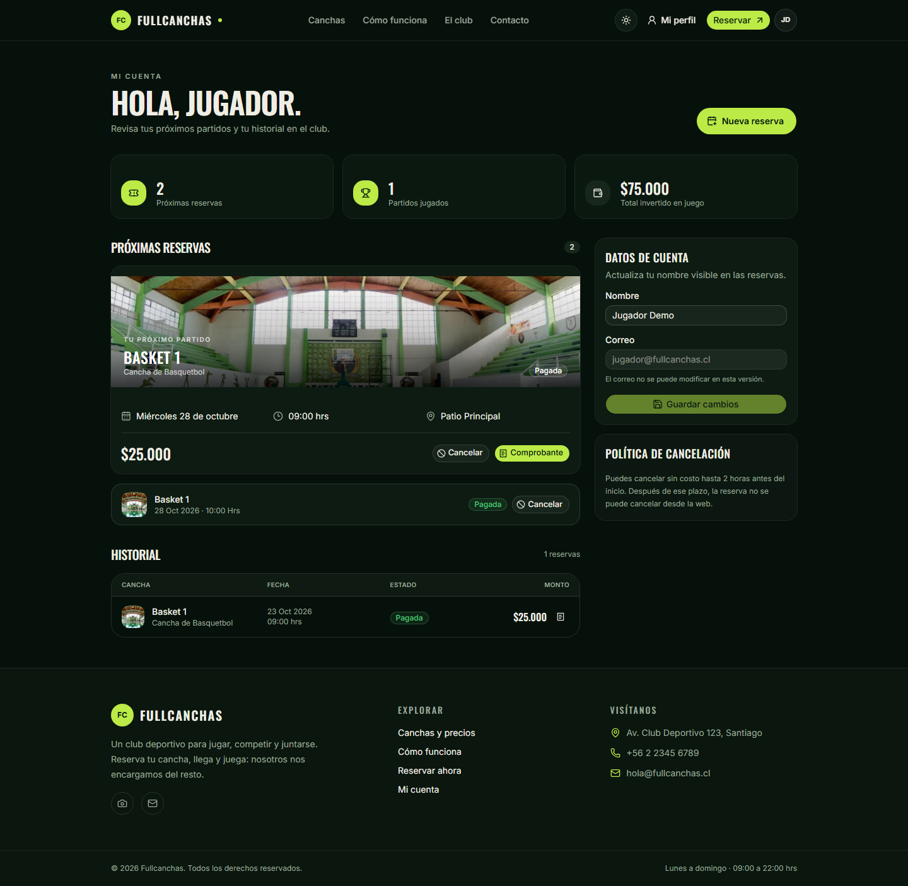 |

## Imágenes

Las fotografías de canchas son locales y se sirven con `next/image` desde `public/images/canchas/`. Provienen de [Pexels](https://www.pexels.com/) y se distribuyen bajo su licencia de uso gratuito. Autores, fuentes y notas de optimización están en [IMAGE_CREDITS.md](IMAGE_CREDITS.md).

## Stack

- **Framework:** Next.js 16.4 (App Router, Turbopack), React 19, TypeScript.
- **Estilos:** Tailwind CSS 4, shadcn/ui con preset Radix Nova, Radix UI, Lucide.
- **Base de datos:** MySQL 8 con Prisma 7 y `@prisma/adapter-mariadb`.
- **Autenticación:** Better Auth 1.7 con email/contraseña, sesiones y plugin admin.
- **Validación:** Zod + React Hook Form.
- **Fechas y moneda:** date-fns + `@date-fns/tz`, `Intl.NumberFormat("es-CL")`.
- **Testing:** Vitest + Testing Library, Playwright.
- **Calidad:** ESLint, TypeScript estricto, GitHub Actions.
- **Empaquetado:** Docker multi-stage + Docker Compose.

## Funcionalidades

### Jugador

- Landing pública con catálogo visual, precios, cómo funciona y llamado a la acción.
- Registro e inicio de sesión con sesión persistente.
- Reserva en tres pasos: tipo/cancha → fecha y hora → resumen.
- Disponibilidad real por cancha y día, slots de una hora entre 09:00 y 22:00.
- Bloqueo temporal de 10 minutos mientras se completa el pago.
- Checkout demo con confirmación y comprobante.
- Perfil con próximas reservas, historial, total invertido y edición de nombre.
- Cancelación sin costo hasta 2 horas antes del inicio.
- Precio guardado al momento de reservar (snapshot).

### Administración

- Dashboard con ingresos del mes, reservas de hoy, pendientes y canchas activas.
- CRUD de canchas: crear, editar, activar/mantener y eliminar si no tienen reservas.
- Edición de precios por tipo de cancha.
- Bloqueo de horarios con motivo y liberación posterior.
- Filtros de reservas por texto, estado, cancha y rango de fechas.
- Cambio de estado de reservas: pendiente, pagada, cancelada, bloqueada.
- Exportación CSV compatible con Excel (UTF-8 con BOM y separador `;`).
- Protección de rutas por rol y estado de cuenta.

## Inicio rápido

### Requisitos

- Node.js 22 o superior.
- pnpm 12 (`corepack enable`).
- MySQL 8 o superior.

### 1. Instalar dependencias

```bash
pnpm install
```

### 2. Configurar variables de entorno

Copia el ejemplo y ajusta las credenciales:

```bash
cp .env.example .env.local
# Windows PowerShell:
# Copy-Item .env.example .env.local
```

Crea las bases de datos y el usuario (ajusta la contraseña):

```sql
CREATE DATABASE fullcanchas
  CHARACTER SET utf8mb4
  COLLATE utf8mb4_unicode_ci;

CREATE DATABASE fullcanchas_shadow
  CHARACTER SET utf8mb4
  COLLATE utf8mb4_unicode_ci;

CREATE USER 'fullcanchas'@'localhost' IDENTIFIED BY 'tu-password';
GRANT ALL PRIVILEGES ON fullcanchas.* TO 'fullcanchas'@'localhost';
GRANT ALL PRIVILEGES ON fullcanchas_shadow.* TO 'fullcanchas'@'localhost';
FLUSH PRIVILEGES;
```

`DATABASE_URL` debe apuntar a `fullcanchas` y `SHADOW_DATABASE_URL` a `fullcanchas_shadow`.

### 3. Migrar y cargar datos demo

```bash
pnpm db:deploy
pnpm db:seed
```

### 4. Ejecutar

```bash
pnpm dev
```

Abre [http://localhost:3000](http://localhost:3000).

## Variables de entorno

| Variable | Requerida | Descripción |
| --- | --- | --- |
| `NEXT_PUBLIC_APP_URL` | Sí | URL pública de la aplicación. |
| `BETTER_AUTH_URL` | Sí | URL base usada por Better Auth. |
| `BETTER_AUTH_SECRET` | Sí | Secreto largo y aleatorio para firmar sesiones. |
| `DATABASE_URL` | Sí | Cadena MySQL de la base principal. |
| `SHADOW_DATABASE_URL` | Solo migraciones | Base auxiliar para `prisma migrate dev`. |
| `TEST_DATABASE_URL` | No | Reservada para pruebas de integración. |
| `PAYMENT_PROVIDER` | No | `demo` por defecto. |

No se debe versionar `.env.local` ni secretos reales.

## Scripts

| Comando | Acción |
| --- | --- |
| `pnpm dev` | Servidor de desarrollo. |
| `pnpm build` | Genera Prisma Client y compila producción. |
| `pnpm start` | Sirve la compilación de producción. |
| `pnpm typecheck` | TypeScript sin emitir. |
| `pnpm lint` | ESLint. |
| `pnpm test` | Tests unitarios y de componentes con Vitest. |
| `pnpm test:watch` | Vitest en modo watch. |
| `pnpm test:e2e` | Tests end-to-end con Playwright. |
| `pnpm db:generate` | Regenera Prisma Client. |
| `pnpm db:migrate` | Crea/aplica migraciones en desarrollo. |
| `pnpm db:deploy` | Aplica migraciones en producción/CI. |
| `pnpm db:seed` | Carga usuarios, tipos y canchas demo. |
| `pnpm db:reset` | Reinicia la base y vuelve a sembrar. |
| `pnpm db:studio` | Abre Prisma Studio. |

## Arquitectura

### Rutas principales

| Ruta | Descripción |
| --- | --- |
| `/` | Landing pública. |
| `/login`, `/registro` | Autenticación. |
| `/reservar` | Flujo de reserva. |
| `/checkout/[id]` | Checkout demo de una reserva pendiente. |
| `/reserva/[id]/confirmacion` | Comprobante de una reserva pagada. |
| `/perfil` | Cuenta, próximas reservas, historial y cancelación. |
| `/admin` | Dashboard administrativo. |
| `/admin/canchas` | Canchas, precios y bloqueos. |
| `/admin/reservas` | Reservas, filtros y exportación. |
| `/api/auth/[...all]` | Endpoints de Better Auth. |
| `/api/admin/reservas/export` | CSV de reservas filtradas. |

### Reglas de negocio

- **Slots:** 13 bloques diarios de 60 minutos, de 09:00 a 21:00 (la cancha cierra a las 22:00).
- **Zona horaria:** todas las fechas se construyen y formatean en `America/Santiago`.
- **Doble reserva:** `Reservation.activeSlotKey` es único. Al cancelar se libera (`null`).
- **Pendientes:** una reserva `PENDING` retiene el slot durante 10 minutos; un proceso de limpieza las expira al consultar disponibilidad o paneles.
- **Pago:** `confirmReservationPayment` cambia a `PAID`, registra `paymentReference` y `paidAt`.
- **Cancelación:** solo `PENDING`/`PAID` y con al menos 2 horas de anticipación.
- **Bloqueos:** se representan como reservas `BLOCKED` sin usuario, con `createdById` del administrador.
- **Precio:** `priceAtBooking` congela el valor del tipo de cancha al crear la reserva.

### Modelo de datos

- `User`, `Session`, `Account`, `Verification`: tablas de Better Auth y rol/estado.
- `CourtType`: nombre, descripción, `pricePerHour` e `imageUrl` opcional para la fotografía del deporte.
- `Court`: nombre, dirección, estado y tipo.
- `Reservation`: usuario, cancha, inicio, estado, precio snapshot, referencia de pago, expiración, notas y `activeSlotKey`.

### Autenticación y autorización

- Better Auth con email/contraseña y sesiones de 7 días.
- `src/server/session.ts` expone `getSession`, `requireUser` y `requireAdmin`.
- `getSession` invalida sesiones de usuarios que no estén `ACTIVE`.
- Las páginas y acciones de administración llaman a `requireAdmin` en el servidor.
- Los guards viven en el servidor; no se depende de `middleware` ni del cliente.

### Pagos

`src/server/payments.ts` define:

```ts
interface PaymentProvider {
  id: string;
  label: string;
  createPayment(request: PaymentRequest): Promise<PaymentResult>;
}
```

El proveedor `demo` confirma siempre y genera una referencia `DEMO-...`. Para integrar una pasarela real se implementa la interfaz y se registra en `providers`.

## Testing

### Unitarios y componentes

```bash
pnpm test
```

Cubren zona horaria, slots, validación de fechas, política de cancelación, claves de slot, formato CLP, proveedor de pago y badges de estado.

### End-to-end

```bash
pnpm exec playwright install chromium
pnpm test:e2e
```

Playwright reutiliza el servidor de desarrollo si ya está corriendo. Los tests requieren una base migrada y sembrada. El test de jugador crea un usuario único, reserva un horario futuro, paga y cancela; el test de administración verifica dashboard, canchas, reservas y exportación CSV.

## CI

`.github/workflows/ci.yml` levanta MySQL 8.4 como servicio y ejecuta:

1. Instalación con lockfile congelado.
2. Prisma generate, migraciones y seed.
3. Typecheck, lint y tests unitarios.
4. Build de producción.
5. Playwright Chromium y tests E2E.

El reporte de Playwright se publica como artefacto si el job falla.

## Docker

```bash
docker compose up --build
```

- Aplicación: [http://localhost:3000](http://localhost:3000).
- MySQL: `localhost:3307` (la app usa `db:3306` dentro de la red).
- El contenedor aplica migraciones al iniciar y ejecuta el seed si `SEED_DATABASE=true`.
- Los datos persisten en el volumen `fullcanchas_mysql`.

Para reiniciar desde cero:

```bash
docker compose down -v
docker compose up --build
```

En producción, define un `BETTER_AUTH_SECRET` propio y no uses las credenciales demo de `docker-compose.yml`.

## Estructura del proyecto

```text
src/
  app/
    (app)/            # reservar, checkout, confirmación, perfil
    (admin)/          # dashboard, canchas, reservas
    (auth)/           # login y registro
    api/              # Better Auth y exportación CSV
  components/
    admin/            # operación administrativa
    auth/             # formularios de sesión
    booking/          # wizard y checkout
    reservations/     # badges y cancelación
    ui/               # shadcn/ui
  lib/                # booking, formato, cliente de auth
  server/             # auth, sesión, Prisma, reservas, pagos y acciones
prisma/
  schema.prisma
  migrations/
  seed.ts
public/
  images/canchas/     # fotografías locales optimizadas (WebP)
e2e/                  # Playwright
screenshots/          # capturas para documentación
IMAGE_CREDITS.md      # autores, fuentes y licencia de las imágenes
```

## Decisiones de diseño

La dirección visual y los tokens están documentados en [DESIGN.md](DESIGN.md). Resumen: verde profundo de club, fondo hueso, acento lima y tipografía Oswald, con un tema oscuro bosque de alto contraste.

## Licencia

[MIT](LICENSE).
